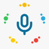
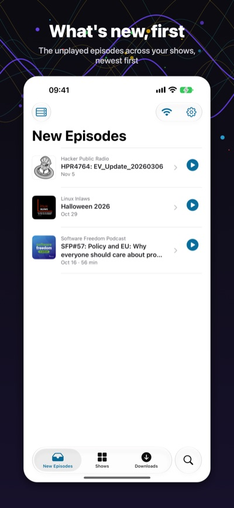
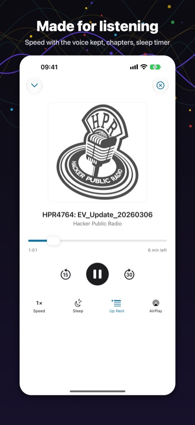
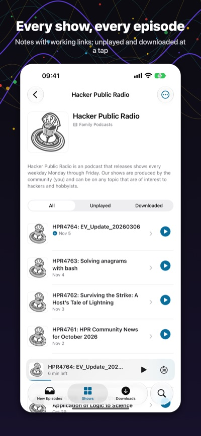
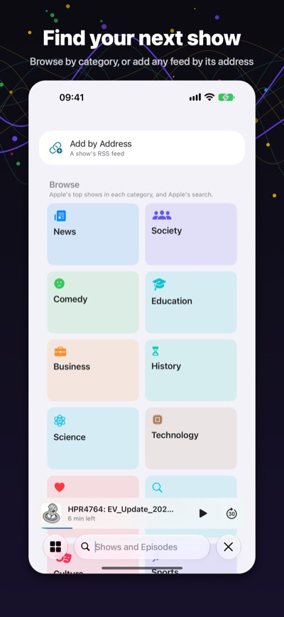

<p align="center">
  
</p>

<h1 align="center">own.audio Podcasts</h1>

<p align="center">A native podcast player for iPhone and iPad that needs no account and no server.</p>

<!-- App Store badge goes here once the app is released, as in music-ios and book-ios. -->

<p align="center">
  <a href="https://own-audio.github.io/podcast-ios/">User guide</a> ·
  <a href="https://www.own.audio">Website</a> ·
  <a href="PRIVACY.md">Privacy</a> ·
  <a href="CHANGELOG.md">Changelog</a> ·
  <a href="https://github.com/own-audio/podcast-ios/issues">Report a problem</a>
</p>

<p align="center">
  
  
  
  
</p>

A native iPhone and iPad podcast player that needs no account and no server: add feeds and
listen. When you do run a server — **own.audio**, **Audiobookshelf** or anything that speaks
the **gPodder** API (podfetch, gpodder.net, own.audio) — your shows, episodes and positions follow you
between devices. Swift and SwiftUI, no web views, no third-party dependencies — a few
megabytes.

Free, for iPhone and iPad; with Apple for review, on its way to the App Store. Runs on iOS 18
and later.

## What it does

- Opens on what is new: unplayed episodes across your shows, newest first
- Up Next across every source, then New Episodes play on
- Speed with pitch correction (per show too), chapters, skip buttons, smart rewind, skip the
  intro, sleep timer; the last episode is back after a relaunch
- Downloads with rules per show (the newest few, delete when played, keep at most), a storage
  limit, and an Offline Mode; positions wait on the phone until a server has them
- Discover: categories to browse, search, and shows like the ones you follow — from an own.audio
  server's catalogue where it has one, else Apple's charts and search; follow by feed address or
  a `feed://` link
- Several servers at once, each reached at the fastest of its addresses; iPad with a sidebar
- A widget, Siri, AirPlay and the player on the lock screen; CarPlay once Apple grants the
  app its entitlement
- With own.audio: the family, signed-in devices, live updates, summaries of an episode and
  questions about it
- English and Czech

Coming, in the order of the plan: OPML import and export, the Podcast Index, and with own.audio
shows shared with the family and translated episodes.

## Why you can trust it

- **It collects nothing.** No account with us, no analytics, no ads, no tracking.
  [PRIVACY.md](PRIVACY.md) lists the only places the app talks to: the feeds you follow, Apple's
  podcast search when you search, the servers you add, and Apple or Google if you sign in with
  them.
- **The code is all here.** Every line of the app is in this repository under the
  [MPL-2.0](LICENSE), with no third-party dependencies — only Apple's frameworks and the
  packages in `Packages/`. The App Store builds come from this repository with
  `scripts/testflight.sh`, and the build number is the commit count.
- **Your shows stay yours.** You follow a show by its feed, with no platform in between; without
  a server, everything stays on the phone.
- **Free, with nothing to unlock.** No in-app purchases and no subscription. The only paid
  thing in own.audio is the optional hosted storage at [own.audio](https://www.own.audio),
  paid on the website.
- **Try it before you set anything up.** "Try the Public Demo" in the add-server form signs
  in to a public demo server, no account needed.
- **Made by a person you can reach.** own.audio Podcasts is built by
  [Kornel Maráz](https://www.own.audio/about/). Problems and questions go to
  [the issues](https://github.com/own-audio/podcast-ios/issues), or to hello@own.audio.


## Build

The plan is in [IMPLEMENTATION_PLAN.md](IMPLEMENTATION_PLAN.md).

Developed with Xcode 27 and [XcodeGen](https://github.com/yonaskolb/XcodeGen); runs on iOS 18
and later.

```bash
brew install xcodegen
xcodegen generate
open OwnAudioPodcasts.xcodeproj
```

## Licence

[MPL-2.0](LICENSE). Changes are listed in [CHANGELOG.md](CHANGELOG.md). own.audio's name and logo are own.audio's; a fork uses its own.

Other servers are marked with the icon each one serves itself, loaded from the listener's own
server while the app runs, as a browser shows a site's icon; the app ships no other project's
artwork. Audiobookshelf's and gPodder's logos are GPL-licensed and podfetch's Apache-licensed,
and their names are their projects' own.
