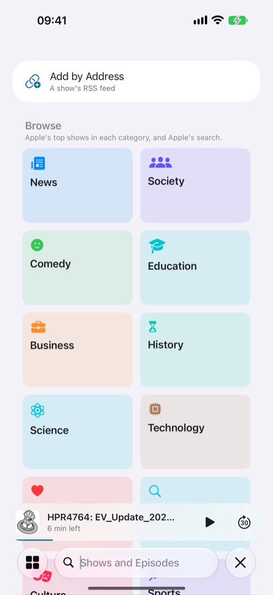

# Discover and search

The **Discover** tab is the magnifying glass. Before you type anything, it shows ways to find
new shows; once you type, it searches.

{: width="300"}

## Before you search

- **Add by Address**: follow a show by its RSS feed address (see
  [Getting started](getting-started.md#follow-a-show-by-its-feed-address)).
- **More Like Your Shows**: shows similar to the ones you followed most recently, each with
  **Because you follow** and the show that brought it up. It is built from what you follow,
  not from what you play. This row appears only when Discover uses an own.audio catalogue.
- **Browse**: a grid of categories (News, Society, Comedy, Education, and so on). Tap one for
  its shows; more load as you scroll.

## Where the shows come from

- **With no own.audio server**, or one without a catalogue: Browse shows Apple's top shows in
  each category, and search uses Apple's podcast search. The header says
  **Apple's top shows in each category, and Apple's search.** Only your search words are sent
  to Apple.
- **With an own.audio server that has a podcast catalogue**: Browse, search, More Like Your
  Shows and Similar Shows all come from that server, and nothing you search for leaves it. The
  header names the server. If you have several own.audio servers, the first that answers with a
  catalogue is used.

Discover needs the network. Offline it says so, and searching still finds your own shows.

## Searching

Type in **Shows and Episodes**. Results appear as you type, in up to three groups:

- **Your Shows**: shows you already follow whose title or author matches.
- **Your Episodes**: episodes whose title matches, from New Episodes, your downloads and Up
  Next. These are found offline too.
- **From** Apple Podcasts or your own.audio server: new shows to follow.

## Following a show you found

Tap a result to see its picture, author and category, then tap **Follow**. If you have a
server that takes new shows, choose where under **Follow On** first. A show you already follow
says **Following — Open the Show**. Similar Shows appear here too, where the catalogue has
them.
