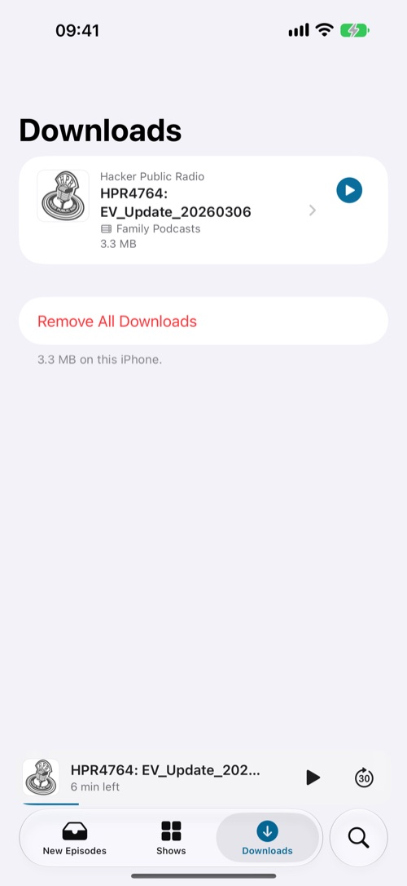

# Downloads and Offline Mode

## Downloading episodes

Download an episode with the arrow on its [page](episode.md), or with **Download** in the menu
when you touch and hold it. Downloads carry on when you leave the app, and pick up where they
stopped if they were interrupted.

To download a show's new episodes by themselves, use **Download New Episodes**,
**Delete When Played** and **Keep at Most** in its [Show Settings](shows.md#show-settings).

Some own.audio episodes can only be streamed; the app then says
**This episode can't be downloaded: the server only streams it.**

## The Downloads tab

{: width="300"}

Everything on the iPhone, newest download first. Each row shows the show, the episode, which
source it came from, and its size (or its progress while downloading). With episodes from more
than one source, they are grouped by source. Episodes from a server you have removed are
listed under **Removed server** and still play.

- Tap a row for the episode's page, or the play button to play it.
- Swipe left for **Remove**, or touch and hold (right-click on a Mac) for the same.
- While downloads run, **Downloading** shows how many. After failures,
  **Retry Failed** tries them all again.
- **Remove All Downloads** deletes every downloaded episode. Under it you see how much space
  the downloads take.

Downloads are not included in your iCloud backup; they can always be downloaded again.

## Download settings

These are in [Settings](settings.md#downloads-and-offline-mode):

- **Download on Wi-Fi Only** (on by default): downloads wait for Wi-Fi.
- **Keep at Most**: a limit for all downloads together: **No Limit** (the default), 1 GB,
  2 GB, 5 GB or 10 GB. Over the limit, played episodes are deleted first, then the ones you
  haven't played for longest. The episode playing is never deleted.

## Offline Mode

Offline Mode makes the app show and play only what is on the iPhone, and ask nothing of feeds
or servers. It is useful on a plane, abroad, or when the signal is poor and you don't want the
app waiting on the network.

Turn it on with the **Wi-Fi** button at the top of [New Episodes](new-episodes.md#the-toolbar),
or with **Offline Mode** in Settings. The app behaves the same way by itself when there is no
network.

While it is on:

- New Episodes says **Offline Mode is on**, and episodes that aren't on the iPhone are greyed
  out.
- Downloaded episodes play, and so do episodes the app kept whole after you streamed them on
  Wi-Fi.
- Discover is not available, but searching finds your own shows and episodes.
- Positions you reach are kept on the iPhone and sent to your servers when you turn Offline
  Mode off.

Trying to play an episode that isn't on the iPhone says
**This episode is not on this device. Download it, or turn Offline Mode off.**

## Streaming and mobile data

Under **Streaming** in Settings:

- **On Mobile Data**: **Stream** (the default) plays as on Wi-Fi. **Downloaded Only** plays
  nothing that isn't on the iPhone while you are on mobile data.
- **Keep Ahead**: 5, 10 (the default) or 15 min. While an episode streams, its next minutes are
  saved on the iPhone, so a tunnel or a gap in the signal goes unheard. With Low Data Mode on,
  it is 5 minutes whatever you choose.

On a Mac there is no mobile data, so **On Mobile Data** and **Download on Wi-Fi Only** are not
shown there.

When you stream an episode on Wi-Fi, the app also keeps a copy of it for a while, so listening
again or seeking back doesn't download it again, and it can play offline. This doesn't happen
on mobile data or with Low Data Mode.
