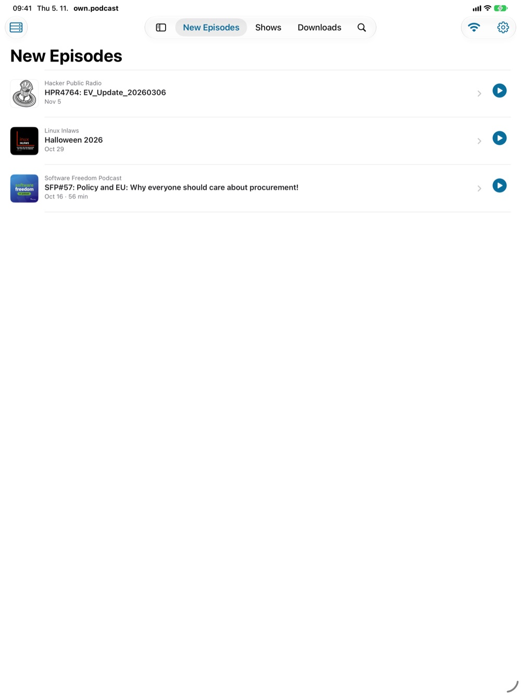
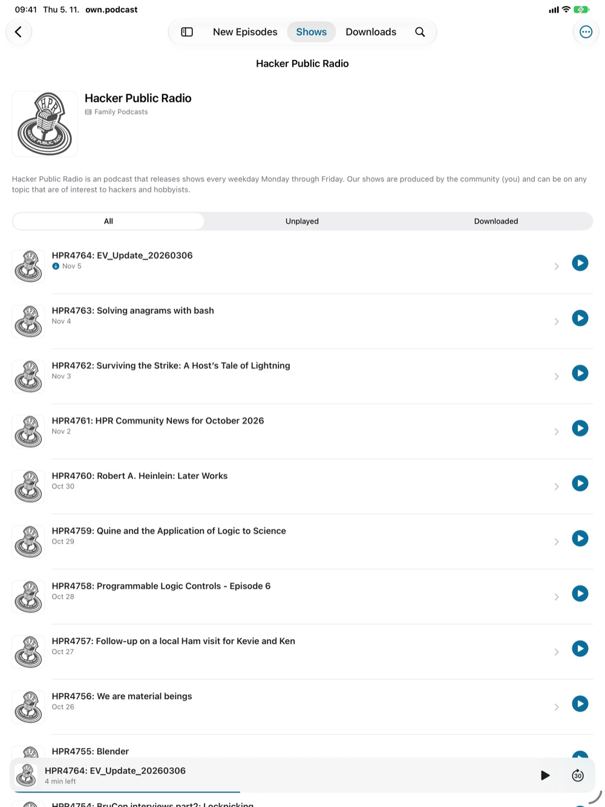

# iPad

The app is the same on iPad, with the room used differently:

- The tabs, **New Episodes**, **Shows**, **Downloads** and the search, sit at the top. The
  sidebar button beside them turns them into a sidebar on the left, and back.
- The iPad works in every orientation. (The iPhone app stays upright.)
- Lists use the whole width, so long episode titles fit on one line.

{: width="600"}

{: width="600"}

Everything else works as described in the rest of this guide.
