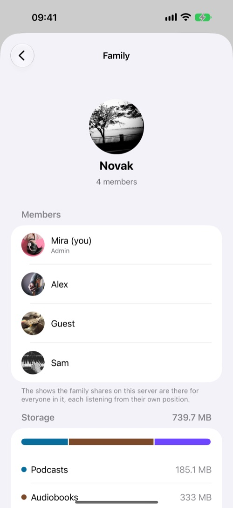

# own.audio extras

An own.audio server is a library for a whole family: music, audiobooks and podcasts, each
person listening from their own position. It can be one you run yourself or own.audio's hosted
service. With an own.audio server added, its page in **Settings** has three more screens:
**Family**, **Devices** and **Listening**.

## Family

{: width="300"}

- The family's picture and name, and how many members it has.
- **Members**: everyone in the family, with **(you)**, **Admin** or **Invited** beside the
  name. The shows the family shares on the server are there for everyone in it.
- **Storage**: what the family keeps on the server, split into **Podcasts**, **Audiobooks**
  and **Music**, shown where the server reports it.
- **Credit**, where the server is paid from prepaid credit (the hosted service):
  **Balance**, **A Month at Today's Storage** and **Lasts About**. The balance turns red when
  the credit has run out.

### Inviting someone (admins)

1. Tap **Invite Someone**. A code is made, and the **Invitation** screen shows it with a QR
   code.
2. Hand it on with **Share Invitation**, let them scan the QR code, or read out the code.
   One invitation is for one person.

Open invitations are listed under **Invitations** with the date they expire. Tap one to show
it again, or swipe it to the left for **Withdraw**.

### Joining another family

**Join Another Family…** asks for the code from that family's admin. After you confirm, you
leave your current family, and what the other family shares appears instead.

## Devices

Every device signed in to your account, this one marked **This device**, with when each was
last used. Swipe a device to the left for **Sign Out**. **Sign Out Everywhere** ends every
session, this iPhone's too, so you will need to sign in again.

## Listening

How long you have listened, from every own.audio app signed in to the account. Choose
**Week**, **Month**, **Year** or **All**.

- **Listened** and **Days in a Row**, and how many audiobooks you finished.
- A chart of minutes per day.
- **By Kind**: music, audiobooks and podcasts.
- **Most Played**.
- **Share with the Family's Admin**: lets the admin see how long you listen and to what kind.
  Off, your listening stays yours.
- If you are the family's admin, **Family** lists each member's total, or **Private** for
  those who don't share it.

## Episode summaries and questions

An own.audio server can offer summaries of episodes that have a transcript. Where it doesn't,
or the episode has no transcript, none of this appears.

Where it does, the [episode's page](episode.md) has a **Summary** section:

- Pick **Short**, **Medium** or **Long**, then **Summarize Episode**. The summary is made from
  the transcript with AI and paid from the family's credit, usually a cent or two; the cost is
  shown under it. Once made, everyone in the family can read it.
- Type in **Ask about this episode** and tap **Ask**. Answers come from the episode's
  transcript only, each one is paid from the family's credit, and your questions are kept for
  you alone. **Clear Questions** deletes your questions and answers for that episode.

Summaries are written in the app's language. If the family's credit is too low, or the day's
limit for paid work is reached, the app says so.

## Discover from your server

An own.audio server with a podcast catalogue takes over [Discover](discover.md): its
categories, its search, **More Like Your Shows** and **Similar Shows**. Nothing you search for
then leaves your server.

## Deleting your account

On the server's page, **Delete Account…** deletes your account on that server for good, with
everything you added to it: music, audiobooks, podcasts, playlists and your listening history.
What others in your family added stays with them. The server's only admin can't delete their
account this way, and the shared demo account can't be deleted.
