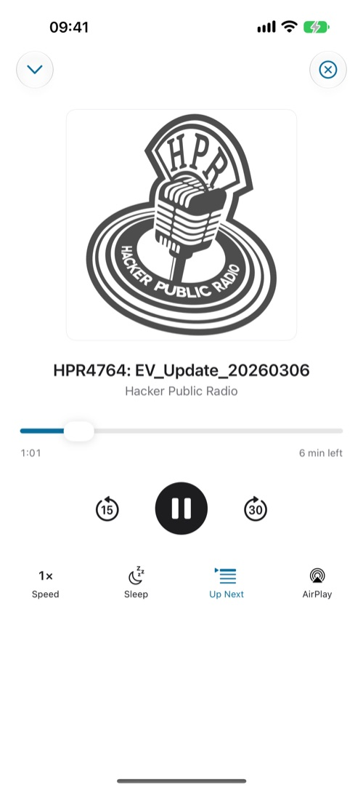

# The player

## The mini player

While an episode is loaded, a bar above the tabs shows its picture, title and time left, with
play/pause and skip forward. A thin line along its bottom shows how far you are. Tap the bar to
open the full player.

When you open the app again after it was closed, the last episode is back in the mini player,
paused where you left it.

## The full player

{: width="300"}

From the top:

- The down arrow closes the player; the episode keeps playing.
- The **×** button (**Stop**) stops the episode and clears it from the mini player.
- The picture, the episode's title and the show.
- The current chapter's name, if the episode has chapters. Tap it for the chapter list.
- The scrubber: drag to move in the episode. Under it, the time played and the time left at
  the current speed.
- Skip back, play/pause, skip forward. The skip buttons show their seconds; you set them in
  [Settings](settings.md#playback) (15 s back and 30 s forward by default).
- The tools: **Speed**, **Sleep**, **Chapters** (only with chapters), **Up Next** and
  **AirPlay**. A tool is coloured while it is in use (a speed other than 1×, a sleep timer
  running, episodes in Up Next).

While streaming, a line under the scrubber may say how many minutes are already saved ahead on
the iPhone, for example **8 min saved**, so you know how long it plays on without a signal. If
the signal is gone and the saved part runs out, it says **No signal — waiting** and plays on by
itself when the signal returns.

## Speed

Tap **Speed**. Use **−** and **+** to change it in steps of 0.05×, or tap one of 0.75×, 1×,
1.25×, 1.5×, 1.75×, 2×, 2.5× and 3×. The range is 0.5× to 3×. The voice keeps its pitch at any
speed.

A show can have a speed of its own in its [Show Settings](shows.md#show-settings); its
episodes start at that speed. Other episodes start at the speed in Settings.

## Sleep timer

Tap **Sleep** and pick **5 minutes**, **15 minutes**, **30 minutes**, **45 minutes**,
**60 minutes**, **End of Chapter** (with chapters) or **End of Episode**.

While a countdown runs, the time left shows on the picture. Open **Sleep** again to see
**Stops in**, **Add 10 Minutes**, or **Turn Off**.

## Chapters

If the feed gives the episode chapters, **Chapters** lists them with their start times, the
current one marked. Tap one to play from there. The lock screen's next and previous buttons
move between chapters too.

## Skip and smart rewind

- **Smart Rewind** (on by default) goes back a little when you resume after a pause: 3 seconds
  after a short pause, up to 30 seconds after an hour or more. Turn it off in Settings.
- **Skip the Intro** is per show, in its [Show Settings](shows.md#show-settings).

## What plays next

When an episode ends, the next one in [Up Next](up-next.md) plays. If Up Next is empty and
**Play New Episodes After Up Next** is on in Settings (the default), the newest episode in New
Episodes that can play now follows.

## AirPlay

The **AirPlay** button in the player picks a speaker, a TV, or headphones.

## Your position

Your position is saved on the iPhone as you listen, and at once when you pause, skip or stop.
For an episode from a server, it is saved on the iPhone first and sent to the server when it
can be; with no network it waits on the iPhone until the server has it.
