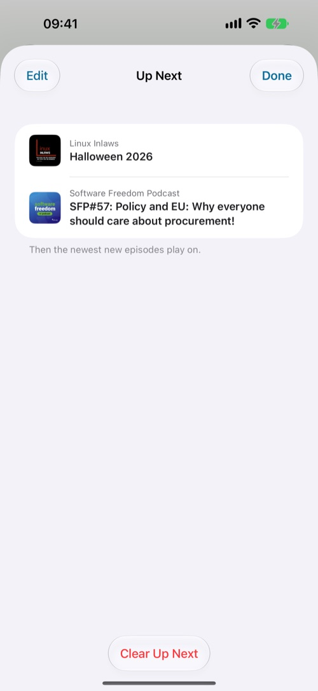

# Up Next

Up Next is your queue: what plays after the episode you are listening to. It can hold episodes
from any show and any source, in the order you choose. It is kept on the iPhone, so it also
works offline.

{: width="300"}

## Adding episodes

- **Play Next** puts an episode first, **Play Later** puts it last. Both are on the
  [episode's page](episode.md) and in the menu when you touch and hold an episode.
- A show with **Add New Episodes to Up Next** in its [Show Settings](shows.md#show-settings)
  adds its new episodes by itself, at the end.

An episode in Up Next has the Up Next symbol beside its date in lists.

## Opening it

Tap **Up Next** in the [player](player.md). In the list:

- Tap an episode to play it now. It leaves the queue.
- Tap **Edit** to drag episodes into a new order, or swipe one to the left to remove it.
- **Clear Up Next** empties it.

If **Play New Episodes After Up Next** is on in [Settings](settings.md#playback), the list
ends with **Then the newest new episodes play on.**

When it is empty, it says **Nothing Up Next**.
